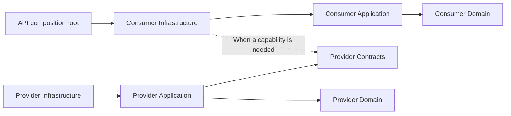

# Backend module boundaries

US-02 introduces separate Domain, Application and Infrastructure assemblies for Identity, Households, Recipes, MealPlanning and Groceries. Each module follows the same structure:

```text
src/Modules/Recipes/
  MealPrep.Recipes.Domain/
  MealPrep.Recipes.Application/
  MealPrep.Recipes.Infrastructure/
```

Domain and Application currently contain no business types. Infrastructure exposes a module registration extension, invoked by the API composition root. Registration currently returns the service collection without adding services. No repositories, use cases, entities or persistence adapters are invented to populate the layers.

## Reference policy

| Source | Permitted project references |
| --- | --- |
| Domain | None |
| Application | Its own Domain and, when introduced, its own Contracts |
| Infrastructure | Its own Application, Domain and Contracts; another module's published Contracts |
| Contracts | None |
| API | Module Application entry points and Infrastructure registration |

Contracts projects are added when a provider exposes a capability required by another module. None are needed by US-02. A consumer defines its outbound port in its own Application; its Infrastructure adapter uses the provider's published interface and immutable projections. Contracts never expose domain entities, DbContexts or framework types. The provider implements the capability using its own layers.



Arrows show code dependencies. Runtime calls follow use cases and ports; project references do not authorize direct database access.

Inner layers currently allow no NuGet packages, explicit DLL references or framework references beyond the implicit .NET runtime. Any necessary package exception must be introduced deliberately with its policy change. Infrastructure references only dependency-injection abstractions for registration; it does not reference the ASP.NET shared framework. No module references another module's implementation.

## Automated checks

Build Release first, then run from the repository root:

```sh
dotnet run --project tests/MealPrep.ArchitectureChecks --configuration Release --no-build
```

The executable uses MSBuild evaluation for Debug and Release to inspect project, package, framework and explicit DLL references, including imports and configuration conditions. It verifies the five required module structures, source project classification, stable assembly names and inclusion in the solution. Release metadata checks additionally catch emitted cross-module dependencies and HTTP/database framework dependencies that may be available through the .NET runtime without a package reference. A missing assembly or failed project evaluation fails the check. CI runs it after compilation in the Backend build job.

The checker validates dependency boundaries, not the behavior of future use cases. It does not validate raw SQL ownership, reflection-based access, dynamically loaded assemblies, the semantic contents of DTOs or all type-level dependencies on the base class library. Narrow contract design, SQL ownership and database mappings still require review and later integration tests. Compiled metadata is checked for Release; reference evaluation covers Debug and Release, not arbitrary custom configurations.
