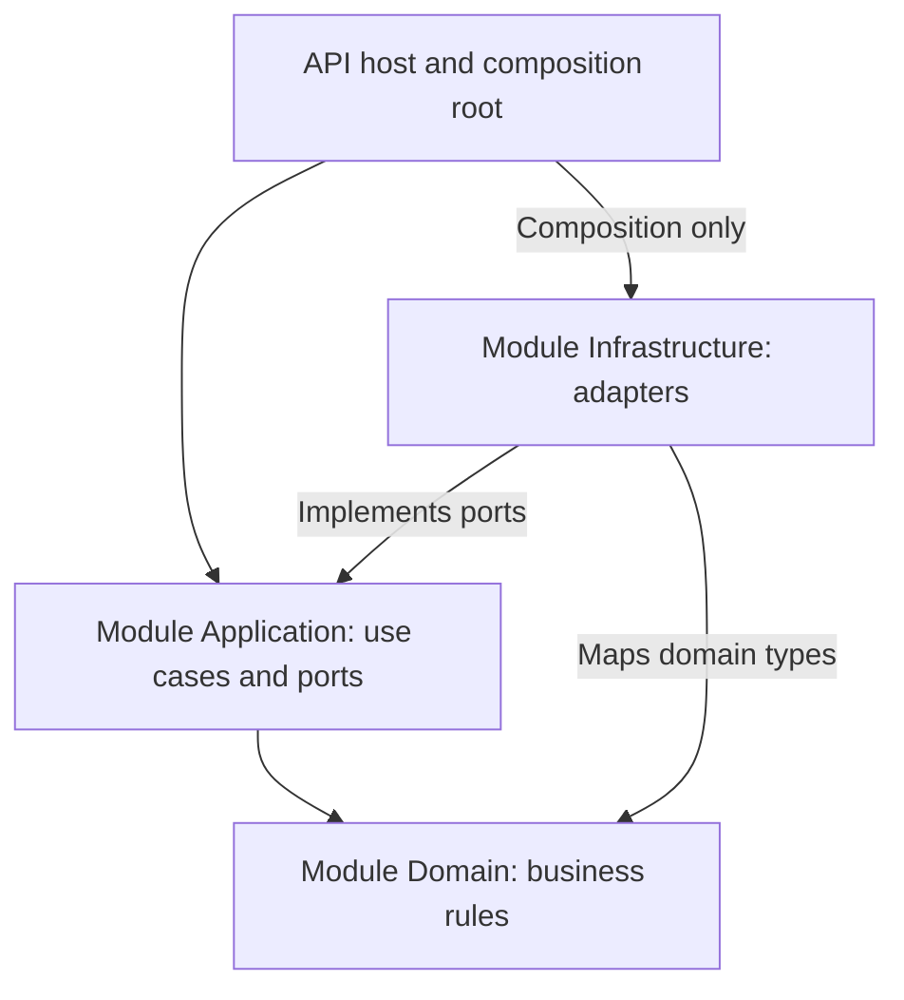
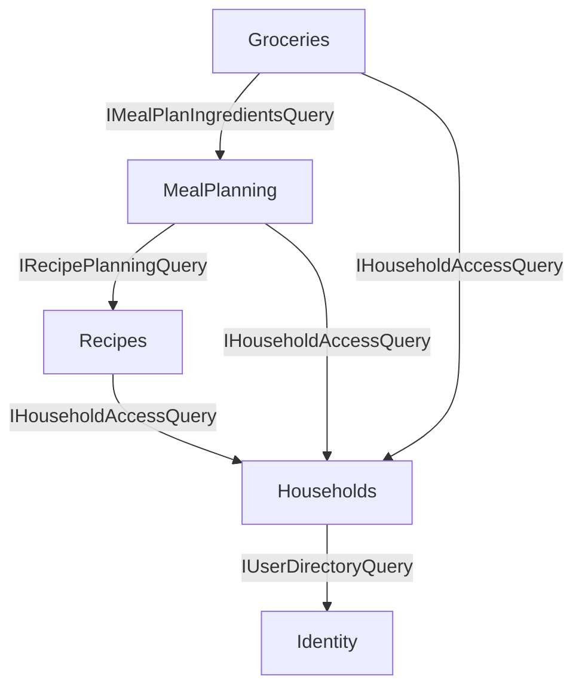
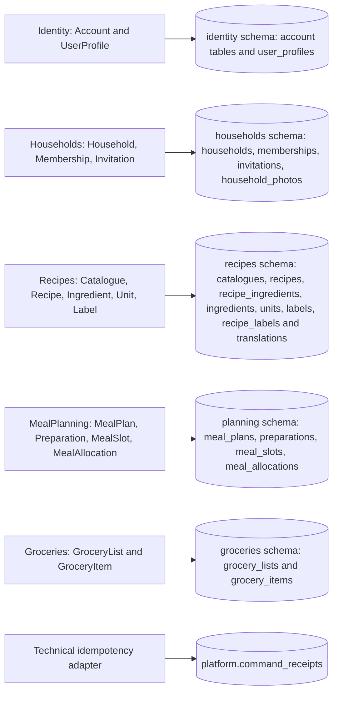
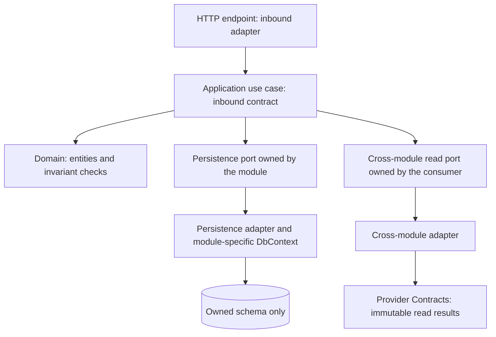
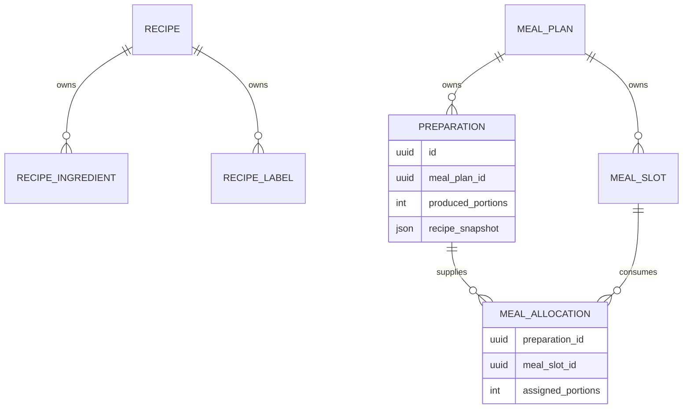
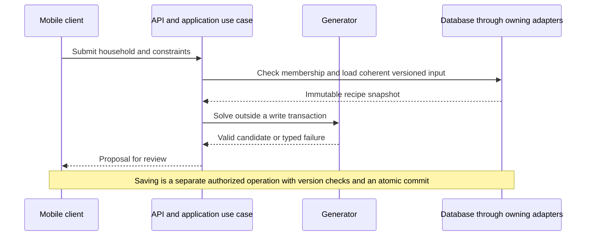
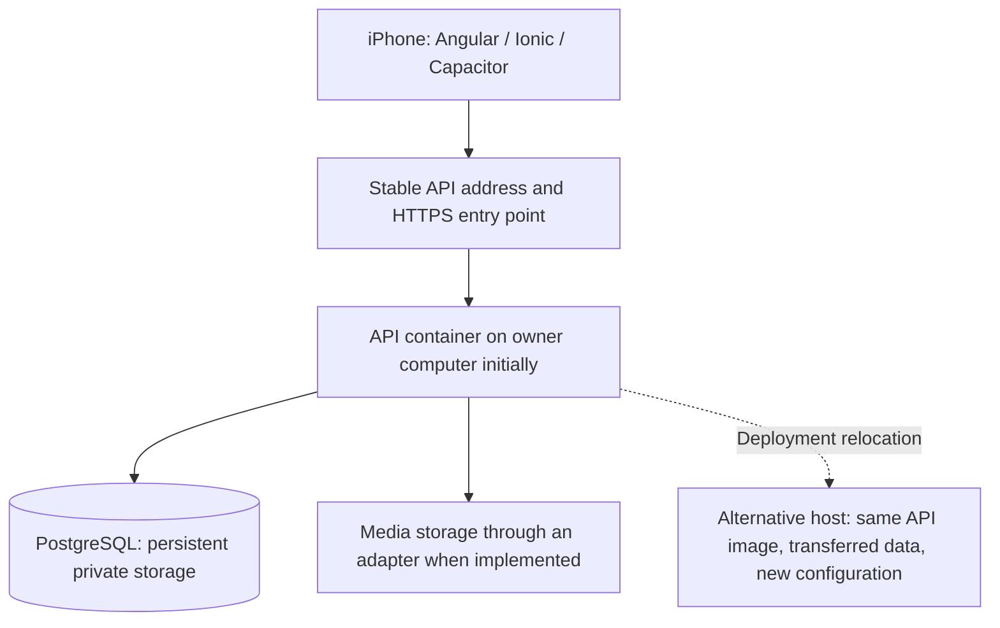

# MealPrepApp architecture

Arc42 structure with 4 plus 1 views and architectural decisions

Version 0.3 | 10 October 2026 | Author Thomas Dufresne

## Summary

MealPrepApp is a connected household meal-planning application. The proposed solution combines an Angular mobile client with Ionic and Capacitor, one modular ASP.NET Core backend with hexagonal boundaries, a central PostgreSQL database and object storage for images. The core model separates recipes, cooking preparations and planned meals. A replaceable planning engine generates portion allocations under user-selected constraints.

The document records a proposed architecture for review and implementation planning. Online-only operation, shared household data, French and English application content, and English engineering documentation are confirmed requirements. Technology selections and implementation mechanisms are proposed unless an architectural decision explicitly states otherwise. No implementation, deployment or successful test execution is claimed.

## Document references

Product requirements: [Phase 1 specifications](specifications.md), Markdown version 0.2 dated 10 October 2026. Requirement identifiers FR-01 through FR-29, NFR-01 through NFR-10 and use cases UC-01 through UC-08 are used for traceability. The specifications remain the authority for product scope; this document proposes mechanisms to satisfy them.

## How to use this document

Sections 1 to 4 describe scope, constraints and strategy. Sections 5 to 7 provide logical, development, runtime and deployment views. Section 8 defines cross-cutting rules. Section 9 records decisions and alternatives; Sections 10 to 12 cover validation, risks and vocabulary. Appendices contain candidate API contracts, persistence structures, execution arrangements and an evaluation checklist.

## 1 Introduction and objectives

### 1.1 Phase 1

The initial release requires a network connection. Users have individual accounts and collaborate through household membership and roles. Authorized users maintain recipes, generate weekly plans and derive grocery lists. Application-owned elements support French and English; user-created content is preserved as entered. Offline storage and synchronization are outside initial scope and do not shape this architecture.

Public, personal and household catalogues are part of the product direction. The release timing and size of the public catalogue remain open. Inventory deduction, nutritional calculation and real-time updates are not assumed.

### 1.2 Use cases covered

| Use cases | Architectural coverage |
| --- | --- |
| UC-01 and UC-02 | Identity and Households modules; central authentication and resource authorization. |
| UC-03 and UC-04 | Recipes module; scoped ownership, explicit copies and optional source provenance. |
| UC-05 and UC-06 | MealPlanning module; constraint generation, preparations and portion allocations. |
| UC-07 | Groceries module; ingredients derived once per preparation. |
| UC-08 | Client translations and translated application-owned reference content. |

### 1.3 Quality attributes

The priority attributes are household data isolation, trustworthy portion and ingredient calculations, maintainability, consistent saved plans, and complete bilingual application content. Performance must be bounded, especially for plan generation, but numerical targets require measurement and product agreement. Section 10 defines planned validation scenarios.

### 1.4 Stakeholders

Thomas Dufresne owns the product and initially develops it. His partner and he are the first household users. Future users require separate private households. Household administrators manage membership, editors maintain recipes and plans, and public-catalogue maintainers manage application-provided content. The architecture must distinguish household roles from application-wide catalogue administration.

## 2 Architecture constraints

### 2.1 Technical constraints

| Constraint | Architectural impact |
| --- | --- |
| Developer experience | .NET 10 and Angular 21 are the preferred starting technologies. |
| iPhone target | Validate Capacitor packaging and device behavior early; borrowed Mac access is limited. |
| Connected operation | Central persistence through HTTPS APIs; no offline mutation queue or local business database. |
| Shared households | Every private operation requires membership and permission checks on the server. |
| Automatic planning | Treat generation as constraint solving with explicit outcomes and bounded work. |
| Bilingual application | Separate stable data identifiers from French and English presentation text. |

### 2.2 Regulatory constraints

Launch territories and jurisdiction-specific obligations remain to be determined. Account information, photos and private household content require access controls and a defined data lifecycle. Before public launch, assess privacy notices, deletion, retention, media permissions and platform distribution requirements. No legal compliance claim or medical interpretation of recipe labels is made here.

### 2.3 Organizational constraints and conventions

Documentation, code identifiers, comments and developer-facing messages use English. French text appears in application translation resources or user content where required. Keep product constraints and architectural decisions explicit, with proposed and accepted statuses. One repository contains the mobile client, backend, tests and documentation. Exact dependency versions are pinned only after compatibility checks.

## 3 Context and scope

### 3.1 Business context

Users create or join households. Recipes may belong to the public catalogue, a user or a household. Planning uses eligible household recipes and labels. A preparation produces portions; planned meals consume allocations of those portions. Grocery totals derive from preparations, not from how many meals consume them.

### 3.2 Technical context

The mobile client communicates with the application API over HTTPS. Only the backend accesses PostgreSQL and authorizes image access. Object storage keeps image bytes while the database stores ownership and object references. An email provider is a future integration candidate for invitation and account workflows; those workflows are not yet finalized. Identity/session integration and hosting providers remain open.

### 3.3 Domain mapping

| Domain concept | Example and rule |
| --- | --- |
| Recipe | Chili with a reference yield of four portions and 400 g of beans. |
| Preparation | Cook six portions of that recipe on Monday; scale scalable quantities by 6 / 4. |
| Planned meal | Assign two portions to Monday dinner and two to Tuesday lunch. |
| Remaining portions | Two portions remain unallocated; their handling must be visible. |
| Label constraint | Require vegetarian recipes and at least fourteen lunch-friendly portions assigned to lunch slots. |
| Household role | Editor may edit household recipes and generate plans; full permission matrix remains open. |

## 4 Strategy

### 4.1 Modularization

| Module | Owned responsibilities |
| --- | --- |
| Identity | User account reference, profile and language preference; candidate Identity integration. |
| Households | Household details, membership, invitations and role assignments. |
| Recipes | Catalogue ownership, recipe contents, labels, ingredients and copy provenance. |
| MealPlanning | Generation constraints, preparations, meal allocations and plan revisions. |
| Groceries | Ingredient aggregation, generated lists and source-plan revision. |

Use one deployable backend process initially. Module boundaries are enforced through use-case and query contracts and code organization. A module must not directly mutate another module's entities. A single database and transaction implementation are sufficient initially; separate services or databases are not required.

### 4.2 Communication between modules

API handlers invoke application use cases. Use cases call domain rules and outbound ports; infrastructure adapters implement persistence, identity and media contracts. Dependency injection is configured in the API composition root. Read contracts return purpose-specific projections rather than exposing another module's mutable entities.

Examples of ports are IRecipePlanningQuery, IMealPlanRepository, IMealPlanGenerator, IHouseholdAccessService and IMediaStorage. These are candidate names, not interfaces implemented in the project. Introduce abstractions for actual boundaries rather than wrapping every class or every EF Core operation.

Planning receives a coherent versioned recipe projection from Recipes and saves preparation snapshots in its own model. Groceries reads a saved plan projection with preparation ingredients and revision. Household access is checked for each use case, including copy destinations. No message broker or event-sourcing infrastructure is proposed for the initial release.

### 4.3 Internal endpoints and REST API

The client uses a public application API; the backend modules communicate in-process. Candidate endpoints appear in Appendix A and are not final contracts. Requests use stable identifiers, explicit quantities and expected resource versions. Database entities are not serialized directly. OpenAPI is proposed for documenting request, response and error schemas.

### 4.4 Industry references

Ionic Angular: Angular integration and Capacitor mobile packaging.
<https://ionicframework.com/angular>

Capacitor environment setup: iOS toolchain and local development prerequisites.
<https://capacitorjs.com/docs/getting-started/environment-setup>

Npgsql EF Core provider: PostgreSQL persistence adapter candidate.
<https://www.npgsql.org/efcore/>

EF Core concurrency: Optimistic concurrency tokens and conflict handling.
<https://learn.microsoft.com/en-us/ef/core/saving/concurrency>

ASP.NET Core Identity: Account-management candidate; session design requires a separate decision.
<https://learn.microsoft.com/en-us/aspnet/core/security/authentication/identity?view=aspnetcore-10.0>

Angular internationalization: Localization concepts; mobile runtime language switching requires validation.
<https://angular.dev/guide/i18n>

References checked on 10 October 2026. They support technology capabilities, not a claim that this application has been implemented or validated.

## 5 Building block view

The logical view is described in Sections 5.1 and 5.2, the development view in Section 5.3, the process view in Section 6, deployment in Section 7 and the scenario view in Sections 1.2 and 6.1.

### 5.1 Decomposition into modules

The backend retains Domain, Application, Infrastructure and API responsibilities. Section 5.4 refines these into module-specific assemblies rather than four shared projects. Each business context owns its layers and publishes only narrow contracts. The following diagram is a conceptual layer view; actual module project names and permitted cross-context references are specified in Section 5.4.6.



Figure 1 Compile-time dependency direction

Domain has no references to HTTP, EF Core, Angular or identity-framework types. Infrastructure references Application and Domain. Api references Application and Infrastructure to wire implementations. The diagram shows code dependencies, not runtime request routing.

### 5.2 Module internal structure

#### Recipes and catalogue ownership

A Recipe belongs to a Catalogue with a scope of Public, Personal or Household. A personal catalogue has one user owner; a household catalogue has one household owner; a public catalogue has neither private owner. Enforce valid ownership combinations in both domain validation and database constraints. Household administrators have no automatic public-catalogue administration rights.

RecipeIngredient records ingredient identity, decimal quantity, unit and scaling policy. Labels use identifiers independent of their displayed names. Shared labels are scoped to their catalogue or household. Duplicate-name normalization and cross-catalogue label mapping require product decisions.

Copying creates a new recipe identity and destination ownership. Source recipe identity and version may be retained as provenance, without a live dependency. Edits to the copy never modify its source. Access to the source and permission to write to the destination are verified. Bilingual source-field retention remains an open product decision.

#### Meal planning model

MealPlan groups its constraints, week, preparations and meal allocations under a household and revision. Preparation records a cooking date, positive produced portions and an immutable RecipeSnapshot for that plan revision. MealSlot records when portions are consumed. MealAllocation links a slot to a preparation and an assigned portion count.

Snapshots preserve recipe title, reference yield, ingredient identities, units, scalable quantities and relevant planning labels. The snapshot representation is proposed. A later recipe edit must not silently change a saved plan or generated groceries. Refreshing a plan from newer recipes is an explicit future workflow to define.

Validate allocations across the aggregate: total assigned portions cannot exceed preparation yield, preparation chronology cannot occur after consumption, and weekly totals and label quotas match the accepted constraints. One portion can satisfy several label quotas but counts once toward total consumption. Lunch-friendly quota totals include lunch-slot allocations only. Storage windows and freezing behavior must be agreed before implying leftover suitability.

#### Generator boundary

IMealPlanGenerator receives immutable recipe candidates and PlanningConstraints, without database or transport dependencies. It returns a candidate plan or a typed outcome such as InvalidConstraints, Infeasible or SearchLimitReached. Success requires a final independent check of all hard constraints. A failed heuristic search alone is not proof of infeasibility.

Start with a bounded constraint-search prototype and benchmark realistic recipe sets. The solver library, algorithm, limits and optional ranking preferences remain open. Generation does not silently relax hard constraints. Keep database transactions short and never hold write locks throughout the solving step.

#### Grocery calculation

GroceryCalculator reads each preparation snapshot once and scales ingredient quantities to produced portions. It groups only compatible ingredient identities and unit dimensions. Mass and volume are not converted without ingredient-specific rules. Count-based ingredients are not merged with mass quantities by assumption. The saved grocery list records its source plan and revision; a changed plan makes that provenance visibly outdated until regenerated.

### 5.3 Code organization

```text
src/
  MealPrep.Api/
  Modules/
    Identity/
    Households/
    Recipes/
    MealPlanning/
    Groceries/
  Platform/
tests/
  Domain.Tests/
  Application.Tests/
  Architecture.Tests/
  IntegrationTests/
client/
  mealprep-app/
docs/
```

Organize the Angular application by features: identity, households, recipes, meal-planning, groceries and settings. Components use feature services and typed API contracts. Server-owned business rules remain on the backend; client validation improves usability but does not replace server checks. A small shared layer contains presentation components, localization and HTTP error handling. No offline persistence abstraction is required initially.

### 5.4 Module contexts entities and database ownership

This section refines the proposed modular monolith into explicit business contexts. A context owns its domain entities, use cases, persistence mappings and schema. Other contexts receive read-only projections through published contracts. The tables below are a proposed logical mapping, not an implemented database schema. They refine Appendix B without changing the agreed connected product scope.

#### 5.4.1 Context responsibilities and ownership

| Context | Aggregate roots and entities | Owned schema and tables |
| --- | --- | --- |
| Identity | Account (identity adapter), UserProfile | identity: account framework tables; user_profiles |
| Households | Household; Membership and Invitation; household photo references | households: households, memberships, invitations, household_photos |
| Recipes | Catalogue, Recipe, Ingredient, Unit, Label; RecipeIngredient and RecipeLabel | recipes: catalogues, recipes, recipe_ingredients, ingredients, units, labels, recipe_labels; translation tables |
| MealPlanning | MealPlan; Preparation, MealSlot and MealAllocation; embedded RecipeSnapshot | planning: meal_plans, preparations, meal_slots, meal_allocations |
| Groceries | GroceryList; GroceryItem | groceries: grocery_lists, grocery_items |

Account storage remains dependent on the selected identity implementation. Translation tables belong to the context that owns the translated content; proposed Recipes tables include recipe_translations, ingredient_translations, unit_translations and label_translations. Application interface translations are client resources, not domain database tables. Image bytes are stored externally; ownership and object keys remain in the owning module records.

The platform.command_receipts table is proposed technical storage for idempotency. It is owned exclusively by the idempotency adapter. It is not an additional business context and cannot be queried directly by business domains. A receipt and its business mutation must participate in the same database transaction.



Figure 4 Context map and cross-module contracts

#### 5.4.2 Database access policy

| Consumer | Direct database access | Access to another context |
| --- | --- | --- |
| Identity adapter | Read/write identity schema only | No household-table access; membership remains owned by Households. |
| Households adapter | Read/write households schema only | User identity and existence through Identity contract. |
| Recipes adapter | Read/write recipes schema only | Household permissions through Households contract. |
| MealPlanning adapter | Read/write planning schema only | Recipe candidates through Recipes; permissions through Households. |
| Groceries adapter | Read/write groceries schema only | Preparation ingredients through MealPlanning; permissions through Households. |
| Technical adapters | Only their explicit technical storage | No blanket permission to mutate all business tables. |

Direct access means SQL or EF access from the owning infrastructure adapter. Controllers, domain entities, application use cases and other modules cannot query those tables. Prohibit cross-module DbSet access, raw SQL joins, mutable EF navigation properties and schema-sharing repositories. Read-only access is also subject to the boundary: another module must not bypass a contract just because it does not write.

A shared database does not automatically enforce this policy. The initial enforcement mechanisms are assembly references, module-specific DbContexts, code review and architecture/integration tests. PostgreSQL schemas name ownership boundaries; hard database isolation requires module-specific credentials and explicit grants, which are a separate deployment choice. This architecture does not claim that schema names alone prevent unauthorized SQL.



Figure 5 Module entities and owned PostgreSQL schemas

#### 5.4.3 Inbound ports outbound ports and communication

Inbound use-case contracts express permitted actions. The consumer defines an outbound port for a cross-module need. Its infrastructure adapter invokes the provider's published Contracts assembly. The provider implements that contract using its own application layer and private persistence adapter. Consequently, a consumer Domain or Application project never references another context's Domain, Infrastructure or DbContext.

| Consumer use case | Provider contract | Permitted result |
| --- | --- | --- |
| Households invites a member | Identity.IUserDirectoryQuery | Minimal user reference or lookup outcome; no credentials or private profile dump. |
| Recipes checks edit permission | Households.IHouseholdAccessQuery | Current allow/deny outcome for actor, household and capability. |
| MealPlanning builds generator input | Recipes.IRecipePlanningQuery | Immutable eligible recipe projection, quantities, labels and source versions. |
| MealPlanning checks generation rights | Households.IHouseholdAccessQuery | Current permission outcome; household role is not a global role. |
| Groceries derives ingredients | MealPlanning.IMealPlanIngredientsQuery | Saved plan revision and immutable preparation snapshots. |
| Groceries checks list access | Households.IHouseholdAccessQuery | Current access outcome for the requested household operation. |

Contract and port names are illustrative. Only expose fields needed by the consumer. Pass actor and scope through the trusted server request context and revalidate authorization at the provider boundary. Do not trust a client-supplied user identity. Cross-module calls are ordinary in-process calls initially, not HTTP calls between modules and not a message broker.

Dependencies follow Identity to Households to Recipes to MealPlanning to Groceries in provider-to-consumer order, with additional household-access queries. Keep these contracts acyclic. A recipe copy between personal and household catalogues remains within Recipes and checks destination permissions; it does not require a separate catalogue service.



Figure 6 Hexagonal structure within a business context

#### 5.4.4 Entity relationships and aggregate invariants

Household owns membership assignments and administrative invariants. UserId is an external identifier from Identity, not a cross-context EF navigation. Catalogue expresses Public, Personal or Household ownership with valid owner combinations. A Recipe owns ingredients and label assignments; changing children advances the protected recipe version. Ingredient, Unit and Label identities remain stable independently of translated names.

MealPlan is the consistency boundary for preparations, slots and allocations. A Preparation contains the source recipe identifier/version as provenance and its own immutable content snapshot. The snapshot is a value object and may be stored as JSONB in the preparations table; it is not a shared Recipe entity. MealAllocation references one preparation and one slot within the same plan. Validate that allocations cannot cross plans or exceed produced portions and that consumption follows preparation.

GroceryList owns its items and records the external MealPlanId, HouseholdId and SourcePlanVersion. It does not hold a live EF navigation into planning tables. Regeneration reads a provider projection and detects or explicitly marks stale plan revisions. Product decisions for manual items and purchased states remain open.

Use foreign keys and constraints within each owned schema. External context identifiers are opaque logical references checked through contracts, with no cross-context cascading deletion. Account/household closure and reconciliation workflows must define how logical references are retired. This trades automatic cross-schema referential enforcement for explicit context ownership and requires dedicated integrity tests.



Figure 7 Recipe and planning aggregate relationships

#### 5.4.5 Transactions versions and consistency

A command normally changes a single aggregate in its owning context transaction. Reads from other contexts precede the short write transaction and return source versions where needed. Never hold a database write transaction while solving a plan. The accepted snapshot gives the saved plan stable meaning; saving still validates permissions, proposal integrity and the agreed freshness rule for source recipes.

Use a module-specific DbContext. The technical command-receipt adapter must explicitly enlist in the same underlying PostgreSQL transaction as the owning mutation, so replay results cannot be committed separately. Sharing a transaction is an infrastructure mechanism and does not grant direct access to another module's entities. No distributed transaction or cross-module event system is introduced for the initial release.

Aggregate version checks include child changes. Consumer projections expose stable contracts, not mutable entity instances. Recipe changes do not propagate into saved preparation snapshots. Current membership checks and source freshness checks have a concurrency window; the authorization cutoff and stronger locking/isolation required for sensitive operations must be specified and tested before implementation. Do not claim cross-context reads plus a local save form one automatically atomic operation.

#### 5.4.6 Assembly boundaries and enforcement

Refine the earlier four-layer layout into module-specific assemblies to make forbidden references detectable at compile time and in architecture tests. US-02 scaffolds Domain, Application and Infrastructure projects for each business module and adds executable dependency checks in CI. Add a small Contracts project only for providers that expose cross-context capabilities; none are required by the current scaffolding. MealPrep.Api is the composition root and hosts HTTP adapters. See [implemented module boundaries](../module-boundaries.md) for the enforced policy and its limits.

```text
src/
  MealPrep.Api/
  Modules/
    Identity/
      MealPrep.Identity.Domain/
      MealPrep.Identity.Application/
      MealPrep.Identity.Infrastructure/
      MealPrep.Identity.Contracts/  # Future: add when a published capability is needed
    Households/    # Same layers; provider Contracts when needed
    Recipes/       # Same layers; provider Contracts when needed
    MealPlanning/  # Same layers; provider Contracts when needed
    Groceries/     # Domain, Application and Infrastructure
  Platform/        # Future: narrow technical adapters when needed
```

Allowed references: Application to its own Domain; Infrastructure to its own Application/Domain and the published Contracts of providers it consumes; provider Application to its own Contracts; Api to application entry points and infrastructure registration. Contracts contain immutable DTOs and capability interfaces without EF Core or domain-entity dependencies. Domain has no outbound project references to other contexts.

Architecture tests should reject cross-module Domain/Infrastructure references, EF types in Contracts, framework dependencies in Domain and DbContext use outside the owning adapter. Integration tests verify the database schema mappings, cross-household denial, snapshot stability and version checks. Project boundaries alone do not validate SQL ownership; raw SQL and migration changes also need review.

## 6 Runtime view

### 6.1 Reference scenarios



Figure 2 Meal-plan generation sequence

Generate and save a plan: authorize the household and load a coherent recipe input snapshot. Solve outside the write transaction and return a proposal for review. When saving, authorize again and verify input versions or a server-verifiable proposal context. Revalidate all plan invariants and commit the full aggregate atomically. Client-supplied prices, quantities, permissions or constraint outcomes are not trusted simply because they were returned earlier.

Edit a shared recipe: load an authorized recipe and its version. The client submits the expected version. Persist with an optimistic concurrency check and advance the root version for changes to ingredients, labels or translated content as well as scalar fields. A stale update returns a conflict; it is not retried as a forced overwrite.

Generate groceries: authorize access, load a consistent saved plan revision and calculate from its snapshots. Persist the list with its source revision. Detect or clearly identify a plan revision change during generation so that the resulting list cannot silently masquerade as current.

Copy a recipe: validate read access to the source and write access to the destination, create a new identity and copy the agreed content, map labels, record optional provenance, and commit atomically. Repeating a retried copy request must not create accidental duplicate copies.

### 6.2 Life cycles

A generated proposal becomes a saved plan only after an explicit save succeeds. Proposals may remain transient initially; identifiers, expiry and integrity strategy require a contract decision. Saved plans receive a revision whenever their meaning changes. Grocery lists retain the revision from which they were calculated.

Membership is checked against current server state for each protected operation. Account deletion, household closure, public-recipe retirement and invitation expiry are unresolved workflows. A referenced recipe may be retired or removed according to the chosen lifecycle policy while preparation snapshots remain usable; provenance must not force cascading deletion of saved plans.

## 7 Deployment view

### 7.1 Deployment topology



Figure 3 Deployment components

Start with one API instance, a central PostgreSQL service and object storage. Keep database access private and secrets outside source control. API process-local state must not be the authority for sessions, idempotency or saved plans if instances are added later. Actual availability, backup objectives and hosting costs remain to be evaluated.

Use Development, Staging and Production with separate configuration, credentials and data. The three environments may initially coexist on the owner's computer; they do not require three physical hosts. Deploy schema migrations as a controlled step, not concurrently from every API instance. Mobile clients may update at different times, so API compatibility and migration rollout require planning.

### 7.2 Startup and demonstration data

Define repeatable local startup for the API and PostgreSQL, with explicit migration and seed steps. Seed a non-production household, users with the three household roles, bilingual application reference data and recipes that exercise vegetarian, lunch-friendly and cold-serving constraints. Do not seed public production accounts or credentials.

An early iPhone prototype validates login, household recipe retrieval, image upload, language switching and connection-failure behavior. Limited access to a Mac makes the iOS build and signing workflow an early risk. The exact native package versions, supported iOS releases and automated build provider remain to be selected.

## 8 Cross-cutting concepts

### 8.1 Persistence and data integrity

Use EF Core with a PostgreSQL adapter as the proposed persistence technology. Keep mappings and migrations in Infrastructure. Use stable identifiers, foreign keys, explicit ownership constraints, positive quantity checks and decimal storage for quantities. Cross-row portion totals require aggregate validation in addition to row constraints.

Use a short transaction boundary for atomic aggregate changes. Section 5.4 proposes a module-specific DbContext and private schema per context, within the same PostgreSQL database. Cross-module reads use contracts; direct access to another context's entities or SQL tables is prohibited. Technical receipt storage must enlist in the owning transaction when idempotency is required.

Optimistic concurrency is proposed for mutable roots. Application-managed versions can protect entire aggregates, including child changes. Database checks must enforce the expected version, not only compare it earlier in memory. Coherent read snapshots and final source-version checks protect generation workflows from mixed inputs.

### 8.2 Idempotence

A connection failure may occur after a server commit. For important creation commands such as copying recipes and saving plans, propose an idempotency key scoped to authenticated actor, destination and operation. Store request fingerprint and committed result atomically with the operation. Reusing a key with different content is rejected; replay after a successful commit returns the original result. Retention and endpoint coverage remain open. This is online retry protection, not an offline operation queue.

### 8.3 Error handling

Return structured errors with stable codes, relevant field identifiers and a trace identifier. Translate user messages in the client, including permission failures, validation and generator outcomes. Developer diagnostics remain English and omit sensitive bodies. Distinguish authentication failure, forbidden access, stale version, invalid input, generation limits and unavailable infrastructure.

The interface reports success only after a confirmed response. If the outcome is uncertain, preserve the current form in memory and offer an appropriate retry or reload. No persistence of edits across offline sessions is promised. Exact HTTP statuses, error schema and retry rules are finalized with the API contract.

### 8.4 API versioning

Propose an /api/v1 route prefix and documented DTOs. Maintain compatibility for supported mobile client versions. Additive changes require contract review, while breaking changes need a version and deprecation policy. Pagination is required for potentially large catalogues. API versioning details and supported-client lifetime remain open.

### 8.5 Security and compliance

ASP.NET Core Identity is a candidate for email/password account management. It is not a finalized mobile session or federated identity solution. Choose the session/token mechanism, secure device credential storage, refresh, revocation and recovery flows in a dedicated decision before coding authentication. Never store a password on the device for automatic login.

Enforce resource authorization using user identity, catalogue ownership and household membership. Never treat a household role as a global application role. Validate upload size, content type and image decoding; choose authorization-aware object retrieval. Detailed quotas, invitation tokens, audit retention and deletion policies remain open.

### 8.6 Internationalization

Store application translation keys and French/English client resources separately from engineering prose. For an in-app language setting, select a translation solution that actually supports the intended mobile switching behavior; Angular localized builds alone are not assumed to deliver it. Regional locales and fallback policy remain open.

Application-owned recipes and reference records have translated text keyed by stable identity and language. Quantities, ownership and label identifiers do not change with language. Personal text remains as entered. Public copies require an explicit policy for bilingual source fields after user editing. Localize dates, numbers, plural forms, unit labels, accessibility text and error explanations. No language choice silently changes measurement systems.

### 8.7 Portable hosting and relocation

The initial backend runs on the owner's computer for the household pilot. Deploy the API as a standard container and PostgreSQL with durable storage. Configure connection strings, API endpoints, credentials and integration settings at runtime. Do not couple Domain or Application projects to a hosting provider SDK.

Use a stable API address so changing the host does not require embedding a new provider address in the mobile client. The entry point and trusted HTTPS configuration are deployment concerns. The pilot may begin on household Wi-Fi; remote reachability is a decision gate, not an assumption that the computer is already publicly accessible.

When media support is implemented, store object keys and ownership metadata rather than provider URLs. Keep the storage adapter replaceable and provide an object-transfer procedure. PostgreSQL relocation uses an explicitly validated backup/restore procedure and supported database versions. Do not assume changing a connection string transfers existing data.

Development, Staging and Production use independent configuration and data. A host change must preserve these boundaries. Keep backups outside the hosting computer and validate restoration before storing real household data. Document reboot, sleep and outage behavior for the pilot.

A relocation rehearsal runs the same API image on another host, restores the database and any implemented media, validates functionality, and switches the test API address. For the small pilot, a planned write freeze and short interruption are acceptable only when agreed. Record a rollback plan and compatible migrations; no zero-downtime migration guarantee is implied.

## 9 Architectural decisions

### ADR-001 Connected initial release

Status: Accepted product direction

Context: The initial users share persistent household data and want to limit initial complexity.

Decision: Require a network connection and central server persistence. Defer offline editing and synchronization.

Consequences: Simplifies persistence and user state. Network failures must remain explicit. Future offline support needs a separate design effort.

Alternative not selected: Offline-first persistence and synchronization are deferred because they add conflict and retry workflows outside the chosen scope.

### ADR-002 Modular monolith with hexagonal boundaries

Status: Proposed

Context: The application has distinct household, recipe, planning and grocery responsibilities and one initial developer.

Decision: Use one backend deployable with module folders, application use cases, domain rules and infrastructure adapters.

Consequences: Supports independent business-rule tests and simpler operation. Boundaries require dependency and code review discipline.

Alternative not selected: Microservices are not selected because independent deployment and distributed coordination are not current requirements.

### ADR-003 Central PostgreSQL persistence

Status: Proposed

Context: Several users modify structured shared data and need transactions, migrations and ownership constraints.

Decision: Use PostgreSQL through EF Core and Npgsql; keep persistence details in Infrastructure.

Consequences: Adds a server database to operate and back up. Integration tests must use PostgreSQL rather than assume identical behavior from another database.

Alternative not selected: SQLite as the central initial database is not selected in this proposal; the original template example was illustrative, not an accepted project decision. SQL Server remains viable if preferred.

### ADR-004 Angular mobile application

Status: Proposed pending device prototype

Context: The developer knows Angular and targets iPhone with limited borrowed-Mac access.

Decision: Evaluate Angular 21, Ionic and Capacitor as the mobile stack.

Consequences: Reuses web skills. Requires compatibility, native packaging, signing and actual-device validation. The interface remains web-rendered inside the mobile runtime.

Alternative not selected: React Native with Expo remains an alternative, especially for the build workflow, but introduces React and different interface primitives.

### ADR-005 Preparation snapshots

Status: Proposed

Context: Recipes remain editable while saved plans and groceries need stable calculations.

Decision: Capture the recipe information used by each saved preparation. New recipe edits do not silently propagate into existing plans.

Consequences: Duplicates some content and requires an explicit refresh policy. Preserves the meaning of saved preparations and their ingredient totals.

Alternative not selected: Live recipe references alone are not selected because edits could change an existing plan without user review.

### ADR-006 Bilingual product with English engineering

Status: Accepted requirement with proposed implementation

Context: Application-owned content must support French and English while documentation and code use English.

Decision: Use stable identifiers, client translation resources and translated application-owned data. Preserve user content as entered.

Consequences: Adds translation completeness checks and bilingual catalogue maintenance. Runtime language switching and source-copy editing rules need validation.

Alternative not selected: Automatic translation of user-created recipes is not required and is not proposed.

### ADR-007 Isolated constraint generator

Status: Proposed

Context: Portion quotas, preparation counts and leftover allocations require more than random recipe selection.

Decision: Use a generator port with immutable input and typed results. Prototype bounded constraint search before selecting a solver.

Consequences: Allows algorithm replacement and focused testing. Search limits and infeasibility explanations need careful handling.

Alternative not selected: Random selection alone is not selected because it cannot reliably satisfy hard quotas and allocation constraints.

### ADR-008 Portable hosting

Status: Accepted requirement with proposed implementation.

Context: Initial hosting is on a personal computer, but a later provider change should not require business-code changes.

Decision: Use a standard API container, PostgreSQL, external configuration, stable API addressing and replaceable integration adapters. Prove relocation through a restoration and cutover rehearsal.

Consequences: Infrastructure configuration still changes between hosts, and existing data must be transferred. Migration effort depends on data volume and the permitted interruption.

Alternative not selected: Provider-specific business persistence or hard-coded service URLs would make relocation more expensive.

### ADR-009 Three separate environments

Status: Accepted direction.

Context: Development and release testing must not change real household data.

Decision: Keep Development, Staging and Production logically isolated, even when hosted on one computer.

Consequences: Maintain distinct configuration, credentials and databases. Additional physical servers are not required for the prototype.

Alternative not selected: A single shared database for development and household use risks mixing test and real data.

### ADR-010 Personal-computer pilot hosting

Status: Accepted for the household prototype.

Context: The first deployment serves one household and a computer is available.

Decision: Start with backend services on the owner's computer, with repeatable startup, persistent data, external backups and a validated phone-to-API access path.

Consequences: Availability depends on the computer and home connection. Remote access, sleep behavior, signing and pilot distribution still require decisions.

Alternative deferred: Managed cloud hosting remains an option for later availability or public-launch needs.

## 10 Quality requirements

### 10.1 Priority quality attributes

Traceability: household isolation maps to NFR-02, concurrency to NFR-03, module boundaries to NFR-04, English engineering to NFR-05, bilingual coverage to NFR-06, device usability to NFR-07 and measured performance to NFR-08. Portion and grocery correctness map to FR-11 and FR-13 through FR-24.

### 10.2 Quality scenarios

| ID | Stimulus and required response |
| --- | --- |
| Q1 | A user requests a resource from another household: reject access without exposing private content. |
| Q2 | Two editors update the same recipe revision: accept one and return a recoverable conflict for the stale update. |
| Q3 | A recipe changes after planning: the saved preparation and its grocery totals remain unchanged. |
| Q4 | Twenty-eight portions are requested with seven preparations and label quotas: validate all constraints or return a precise non-success outcome. |
| Q5 | One preparation supplies two meals: grocery ingredients are counted once for the produced yield. |
| Q6 | The connection drops after a copy or save: a supported idempotent retry creates no duplicate. |
| Q7 | A user changes language: application-owned content changes language while quantities and user text retain meaning. |
| Q8 | Generation reaches its search limit: return a bounded failure distinct from proven infeasibility. |

### 10.3 Test strategy and results

Plan domain tests for scaling, label quota overlap, portion conservation, chronology and unit compatibility. Use application tests with controlled ports for permissions, generator outcomes and snapshot handling. Use real PostgreSQL integration tests for transactions, mappings, versions and idempotency. Add contract tests and iPhone workflow checks for bilingual screens and error recovery.

Benchmark generator inputs of increasing size, with both feasible and conflicting constraints. Agree response-time and catalogue-size targets after measurements. Validate backup restoration and migrations before public launch. All checks in this document are planned; no test execution results or performance measurements exist yet.

## 11 Risks and technical debt

| Risk | Impact and mitigation |
| --- | --- |
| Unbounded generation | Large search space may delay requests. Prototype early, measure input sizes and bound solving work. |
| Open planning semantics | Exact preparation counts, leftovers and quota meaning affect correctness. Resolve relevant specification decisions before finalizing the solver. |
| Limited Mac access | Native build and device issues may block distribution. Validate a minimal iPhone build and repeatable signing early. |
| Ownership mistakes | Copies or shared queries may expose private content. Centralize scoped access checks and test cross-household requests. |
| Recipe and plan drift | Live changes can corrupt historical calculations. Use preparation snapshots and explicit plan revision provenance. |
| Translation gaps | Default content and errors can appear in the wrong language. Check complete resource coverage and both-language workflows. |
| Unchosen identity workflow | Session and recovery choices affect mobile security. Resolve the authentication decision before account implementation. |
| Weak module boundaries | A layered project layout alone does not prevent coupling. Review references and prohibit cross-module entity mutation. |

Tracked decisions still required: exact dependency compatibility, hosting and region, identity/session mechanism, media quotas, solver and generation limits, preparation-count semantics, public-catalogue release scope, catalogue copy rules, leftover policy, translation runtime and measurable operational targets. Refer to OD-01 through OD-12 in the specifications for the corresponding product decisions.

## 12 Glossary

### 12.1 Business language

| Term | Definition |
| --- | --- |
| Recipe | Reusable dish definition with reference yield, ingredient quantities and labels. |
| Preparation | One cooking occurrence producing portions and carrying a recipe snapshot. |
| Planned meal | A dated meal slot consuming allocated portions. |
| Allocation | Assignment of a portion count from one preparation to one meal slot. |
| Catalogue | A collection scoped to the public application, one user or one household. |
| Constraint | A validated eligibility rule, portion quota or planning requirement. |
| Revision | A version identifying the saved meaning of a mutable resource. |
| Port | A contract owned by the application or domain boundary. |
| Adapter | An implementation connecting a port to a concrete technology. |

### 12.2 Acronyms

ADR: Architectural Decision Record. API: Application Programming Interface. DTO: Data Transfer Object. EF Core: Entity Framework Core. HTTPS: Hypertext Transfer Protocol Secure. REST: Representational State Transfer. UC: Use Case.

## Appendix A Candidate API contracts

Candidate routes below illustrate responsibilities. They are not implemented or approved contracts. Account and invitation routes depend on the pending authentication design. Protected routes derive actor identity from authentication and check ownership for the supplied resource identifiers.

| Method | Route | Intent |
| --- | --- | --- |
| POST | /api/v1/households | Create household |
| POST | /api/v1/households/{id}/invitations | Proposed invitation workflow |
| PUT | /api/v1/households/{id}/members/{userId}/role | Assign household role |
| GET | /api/v1/catalogues/{id}/recipes | List authorized recipes with pagination |
| POST | /api/v1/catalogues/{id}/recipes | Create editable recipe |
| PUT | /api/v1/recipes/{id} | Edit recipe with expected version |
| POST | /api/v1/recipes/{id}/copies | Copy to authorized destination |
| POST | /api/v1/households/{id}/meal-plan-proposals | Generate without saving a plan |
| POST | /api/v1/households/{id}/meal-plans | Validate and save candidate plan |
| GET | /api/v1/meal-plans/{id} | Read authorized saved plan |
| POST | /api/v1/meal-plans/{id}/grocery-lists | Derive list for expected plan revision |

Planning input contains week, meal slots and requested portions, preparation-count criteria, label identifiers and minimum quotas. A proposal contains preparations, allocations, unallocated portions and criterion totals. A saved resource exposes an opaque version; mutations provide the expected version. Structured errors contain code, field details where appropriate and traceId. Final serialization and HTTP statuses remain to be agreed.

## Appendix B Persistence model

| Entity group | Relationships and integrity |
| --- | --- |
| User and UserProfile | Account reference and language preference; identity-framework tables are adapter details. |
| Household and Membership | Membership links user and household; unique pair and explicit household role. |
| Catalogue and Recipe | Scope-specific owner constraints; recipe belongs to exactly one catalogue. |
| Ingredient and Unit | Stable identities and dimensions; decimal recipe quantities and explicit compatibility. |
| RecipeIngredient and RecipeLabel | Children of recipe; mutations advance the protected recipe root version. |
| Application translations | Translated fields keyed by content identity and supported language; user content remains separate. |
| MealPlan and Preparation | Household-owned plan root, revision, constraints and preparation snapshots. |
| MealSlot and MealAllocation | Allocations reference preparations and obey yield and chronology invariants. |
| GroceryList and GroceryItem | Household access follows the source plan; record source plan revision. |
| MediaReference | Object key, scope and owner metadata; image bytes remain in object storage. |
| IdempotencyRecord | Proposed unique actor/operation/key scope, request fingerprint and atomic committed result. |

This is a conceptual schema. Section 5.4 provides the proposed context-owned table mapping and access policy. Names, indexes, snapshot storage format, deletion policies and migrations remain to be validated. Validate queried indexes against ownership and actual workloads. Source recipe deletion must not cascade into saved preparation snapshots.

## Appendix C Containerization and execution

Propose a container image for the API and local orchestration for the API and PostgreSQL. Native iOS compilation uses a macOS toolchain separately from backend containers. Define development configuration, health checks, migrations and seed commands after the repository scaffold exists. No executable startup instructions are claimed in this document.

Production requires protected database connectivity, object storage configuration, backups, a tested restoration process, HTTPS and externalized secrets. Image adapter development can use a local test implementation, while production access control must remain equivalent. Provider selection and release automation are pending.

## Appendix D Evaluation checklist

| Criterion | Current assessment | Evidence required |
| --- | --- | --- |
| Scope alignment | Documented proposal | Resolve relevant open specification decisions. |
| Module boundaries | Scaffolded in US-02 | Project references and executable architecture checks; database ownership integration tests remain future work. |
| Planning correctness | Not implemented | Domain cases, solver checks and benchmark results. |
| Shared-data isolation | Not implemented | Authorization and cross-household integration tests. |
| Persistence and concurrency | Not implemented | PostgreSQL mappings and concurrent-write tests. |
| Bilingual behavior | Requirement confirmed | Translation completeness and both-language device checks. |
| iPhone delivery | Not validated | Repeatable signed build and physical-device prototype. |
| Operational readiness | Not validated | Deployment, migration and backup-restore evidence. |
